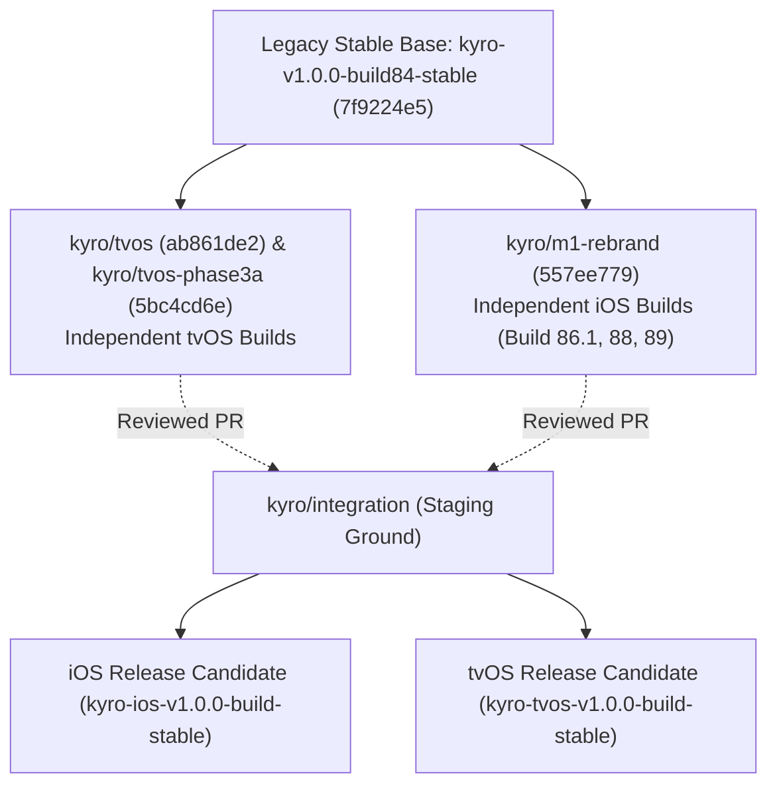

# Kyro Development, Integration & Release Workflow

**Last Updated:** 2026-11-17  
**Tracking System Version:** 1.1.0

---

## 1. Branch Strategy & Architecture

To allow iOS and tvOS to progress independently without diverging irreconcilably, Kyro adopts a decoupled development model with coordinated integration:



### Development Branches
1. **Canonical iOS Development Branch (`kyro/ios` / `kyro/m1-rebrand`):**
   - Owns all iPhone and iPad features, layout updates, touch interactions, Picture-in-Picture, local notifications, and companion sender flows.
   - Latest checkpoint: Build 88/88.2 (`557ee779`).
2. **Canonical tvOS Development Branch (`kyro/tvos`):**
   - Owns Apple TV UI/UX, 10-foot typography, Siri Remote focus navigation (`TVKyroFocus`), Top Shelf integration, TV Guide, and companion receiver.
   - Latest checkpoint: Phase 3A (`5bc4cd6e`).
3. **Integration Staging Branch (`kyro/integration`):**
   - Dedicated staging area for synchronizing shared Swift files, testing cross-platform compatibility, and preparing release candidates.
   - **No automatic broad branch merges:** Never bulk-merge feature branches. Features must be staged via reviewed pull requests or targeted cherry-picks with focused regression validation.

---

## 2. Release & Tagging Policy

### Independent Build-Number Sequences
- **iOS and tvOS build numbers are independent.**  
  iOS iterates rapidly on phone-specific features (e.g. Build 85, 86, 88, 89), while tvOS iterates on Apple TV phases (e.g. Build 84 Phases 1–3A). Forcing unified lockstep numbering creates artificial gaps and deployment friction.
- Each platform target (`Silo` vs `SiloTV`) in `iosApp/project.yml` maintains its own build number sequence, passed explicitly during archiving via `CURRENT_PROJECT_VERSION`.

### Platform-Specific Stable Tagging
- Future stable releases must use platform-qualified tags:
  - iOS Stable: `kyro-ios-v1.0.0-build<N>-stable`
  - tvOS Stable: `kyro-tvos-v1.0.0-build<N>-stable`
- **Preservation of Legacy Tags:**  
  All pre-existing stable tags must remain untouched to guarantee historical provenance:
  - `kyro-v1.0.0-build84-stable`
  - `kyro-v1.0.0-build77-stable`
  - `kyro-v1.0.0-build70-stable`
  - `kyro-v1.0.0-build69-pip-verified`
  - `kyro-v1.0.0-build62-stable`
  - `kyro-build-26`

### Release Verification Gates
1. **Committed Input & Reproducibility:**  
   - Every IPA must record its exact source Git commit SHA, branch, and included feature IDs.
   - Builds packaged from a dirty working tree (`git status -s` > 0) are strictly classified as **nonreproducible checkpoints** unless a full, verified patch/diff snapshot is archived alongside the binary.
   - Stable releases MUST be built from a 100% clean, committed commit.
2. **Physical-Device Acceptance Gate:**  
   - An IPA cannot be tagged as `-stable` solely based on compilation or simulator tests.
   - Physical hardware verification on device (`iPhone 16 Plus` / `Living Room Apple TV 4K`) is mandatory before minting a stable release tag.

---

## 3. Shared Swift File Ownership & Integration Rules

Several files in the codebase are compiled by both iOS and tvOS targets (`Silo` and `SiloTV`).

### Classification & Modification Guidelines

| Category | Paths | Rules |
| :--- | :--- | :--- |
| **Pure Shared Core** | `Pairing/LiveTV/LiveTVPairing*.swift`<br>`LiveTV/EPG/*` | Pure Swift domain logic. Zero UIKit/AppKit/SwiftUI/TVMLKit imports. Bit-for-bit identical across all branches. |
| **Shared Platform Services** | `LiveTV/LiveTVService.swift`<br>`LiveTV/LiveTVBrowseModel.swift` | Logic shared by both platforms. Wrap platform differences in `#if os(iOS)` or `#if os(tvOS)` blocks (e.g. inline video player vs full-screen TV player). |
| **Shared UI Views** | `LiveTV/LiveTVViews.swift`<br>`LiveTV/Guide/LiveTVCategoryBrowser.swift`<br>`ContentView.swift` | **Avoid monolithic shared views.** Split platform UI into dedicated files (`TVLiveTVView.swift` vs `LiveTVViews.swift`). Shared wrappers must use clean conditional guards. |
| **Manifests & Schemes** | `project.yml`<br>`Info.plist`<br>`tvOS-Info.plist` | Target-specific keys live in platform Info plists. Build numbers must be cleanly configurable per target. |

### Integration Verification Checklist
Before any shared-code integration is merged into `kyro/integration`:
1. Compile both targets:
   ```bash
   xcodebuild build -project iosApp/Silo.xcodeproj -scheme Silo -destination generic/platform=iOS CODE_SIGNING_ALLOWED=NO
   xcodebuild build -project iosApp/Silo.xcodeproj -scheme SiloTV -destination generic/platform=tvOS CODE_SIGNING_ALLOWED=NO
   ```
2. Run focused unit test suites on both platforms (`SiloTests` and `SiloTVTests`).
3. Verify that changes to shared files do not alter the behavior or layout of the un-modified platform.

---

## 4. Host-Wide Xcode Build Lock

To prevent resource starvation, DerivedData lock contention, and build collisions between concurrent T3 conversations on the host Mac, **only one heavy Xcode operation may run at any time**.

### Audit & Security Properties (`kyro-build-lock.sh`)

1. **Atomic Acquisition:**  
   Uses atomic directory creation (`mkdir /tmp/kyro_xcodebuild.lock.d`). On POSIX systems, `mkdir` is guaranteed atomic at the kernel level.
2. **Process Liveness & PID Reuse Protection:**  
   In addition to verifying process existence via `kill -0 <PID>`, the lock records the lockholder's process start time (`lstart`). If the PID exists but its `lstart` does not match the recorded timestamp, the lock recognizes that the original process died and the OS recycled the PID, safely triggering recovery.
3. **Race-Free Stale Lock Recovery:**  
   When a dead or stale lock is detected, the script does not perform an unsafe `rm -rf`. Instead, it uses an atomic rename (`mv "$LOCK_DIR" "$LOCK_DIR.stale.$$.$RANDOM"`). Only the process that successfully renames the directory proceeds to clean it up, preventing race conditions between concurrent waiting processes.
4. **External Xcode Detection:**  
   The script checks `pgrep -f "xcodebuild"` for external Xcode processes running outside the lock (e.g. from Xcode GUI or external terminals). If active, it gracefully waits until the host is idle.
5. **Non-Destructive Guarantee:**  
   Never terminates another agent's or user's processes (`kill -9` prohibited).
6. **Automatic Cleanup Traps:**  
   Traps on `EXIT`, `INT`, `TERM`, and `HUP` ensure the lock is automatically released upon script termination or failure, verifying that the current PID matches the recorded lock metadata before removal.
7. **No DerivedData Deletion:**  
   Global cleanup or deletion of `~/Library/Developer/Xcode/DerivedData` is strictly prohibited.

### Usage
```bash
<repo>/docs/kyro-development/scripts/kyro-build-lock.sh <command>
```
